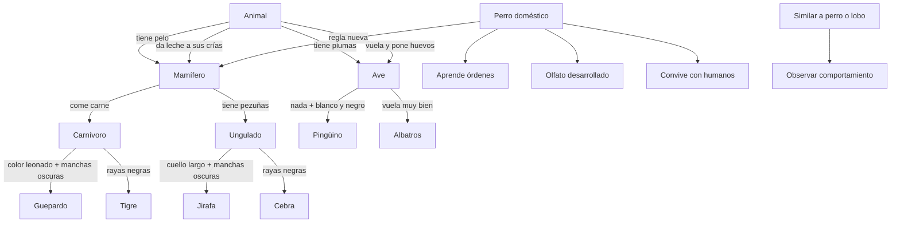

# Ontología de clasificación de animales

## 1. Propósito

Esta ontología organiza los hechos y las reglas formalizadas en la actividad de adquisición de conocimiento. Representa animales, características observables y categorías que se infieren mediante reglas.

## 2. Conceptos y predicados

- **Animal:** `animal(X)`
- **Características:** `tiene_pelo(X)`, `da_leche(X)`, `tiene_plumas(X)`, `vuela(X)`, `pone_huevos(X)`, `come_carne(X)`, `tiene_pezuñas(X)`, `color_leonado(X)`, `manchas_oscuras(X)`, `rayas_negras(X)`, `cuello_largo(X)`, `nada(X)`, `blanco_negro(X)`, `vuela_muy_bien(X)`.
- **Categorías:** `mamifero(X)`, `ave(X)`, `carnivoro(X)`, `ungulado(X)`, `guepardo(X)`, `tigre(X)`, `jirafa(X)`, `cebra(X)`, `pinguino(X)`, `albatros(X)`.
- **Perro doméstico:** `perro_domestico(X)`, `aprende_ordenes(X)`, `olfato_desarrollado(X)`, `similar_a_perro_o_lobo(X)`, `convive_con_humanos(X)`.

## 3. Diagrama de relaciones

## 4. Reglas de inferencia

1. Si un animal tiene pelo, entonces es mamífero.
2. Si un animal da leche a sus crías, entonces es mamífero.
3. Si un animal tiene plumas, entonces es ave.
4. Si un animal vuela y pone huevos, entonces es ave.
5. Si un mamífero come carne, entonces es carnívoro.
6. Si un mamífero tiene pezuñas, entonces es ungulado.
7. Si un carnívoro tiene color leonado y manchas oscuras, entonces es guepardo.
8. Si un carnívoro tiene rayas negras, entonces es tigre.
9. Si un ungulado tiene cuello largo y manchas oscuras, entonces es jirafa.
10. Si un ungulado tiene rayas negras, entonces es cebra.
11. Si un ave nada y es blanca y negra, entonces es pingüino.
12. Si un ave vuela muy bien, entonces es albatros.
13. Si un animal tiene pelo y da leche a sus crías, entonces es mamífero.
14. Si un animal es perro doméstico, entonces pertenece al grupo de los mamíferos.
15. Si un animal es similar a un perro o un lobo, se debe observar su comportamiento para intentar distinguirlo. Esta última es una recomendación de observación, no una clasificación automática.

## 5. Hechos de la entrevista

Para el perro doméstico, la actividad registra los siguientes hechos:

- Es un animal y tiene pelo.
- Las hembras producen leche para alimentar a sus crías.
- Es perro doméstico.
- Puede aprender órdenes.
- Tiene el olfato desarrollado.
- Convive con seres humanos.
- Puede tener características físicas similares a las de un perro o un lobo; para distinguirlos se observan también el comportamiento, el tamaño, la forma del cuerpo y su relación con los seres humanos.

## 6. Nota sobre los ejemplos de código

El archivo `hechos_animales.py` incluye ejemplos de animales para probar la inferencia de las reglas. Los ejemplos se identifican con el sufijo `_ejemplo` y sirven únicamente para verificar el funcionamiento del programa; los hechos de la entrevista que aparecen en la actividad son los del perro doméstico.
